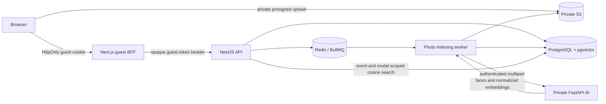

# Architecture

NestJS owns authentication, tenancy, guest sessions, consent, queue state, vector persistence/search, result expiry, and auditing. Python owns image validation, orientation, detection, alignment, quality assessment, and inference. Python is private and has no cross-event identification logic.

Indexing replaces a photo's embeddings transactionally after verifying the photo and event still exist. A valid no-face image becomes `READY` with `faceCount=0`. Deleted photos cannot be restored by stale workers.

Search requires an active event-scoped opaque session, current consent, an available event, exactly one acceptable selfie face, compatible model version, an event-filtered threshold pass, photo deduplication, and owned unexpired result access.

Model changes never mix embeddings. Every embedding and search records `modelVersion`; the administrative reindex endpoint queues incompatible photos in bounded batches.

## Guest journey and downloads

The browser creates an event-scoped session through same-origin `/api/guest/*` route handlers. The BFF removes the opaque token from the JSON response and stores it in an HttpOnly, SameSite cookie. State-changing requests reject cross-origin `Origin` and `Sec-Fetch-Site` values. PIN verification remains in NestJS and uses the existing Argon2 hash.

Selfies live only in page memory until one multipart search request. The synchronous Phase 3 search returns an opaque search ID; result and download authorization is re-evaluated in NestJS. Original photo downloads use two-minute presigned URLs. Download-all creates a `GuestDownloadJob`, streams a ZIP through BullMQ to private derivative storage, and returns a two-minute URL only while session, consent, search, and event authorization remain valid.

## Professional import and derivatives

The browser incrementally hashes each original and uploads directly to the configured private
S3-compatible provider. Files above the configured threshold use resumable multipart upload with
bounded file and part concurrency. NestJS owns server-generated keys, part authorization,
completion verification, quotas, idempotency, and abandoned-session cleanup; image bytes do not
flow through Next.js or NestJS.

Derivative workers stream one original at a time to an isolated temporary file, generate bounded
thumbnail, preview, and AI-input objects, and remove the temporary file in a `finally` path. AI
indexing reads the bounded AI input rather than the original. RAW originals that the deployed
libvips build cannot decode remain preserved and are marked accurately instead of being reported as
processed.

Selected-photo exports reuse the private ZIP worker. The API intersects every requested UUID with
the caller's current event-scoped result grant before queueing. The worker streams originals into a
ZIP64 archive and uploads that archive directly to private derivative storage; it does not buffer
the full archive in memory.
